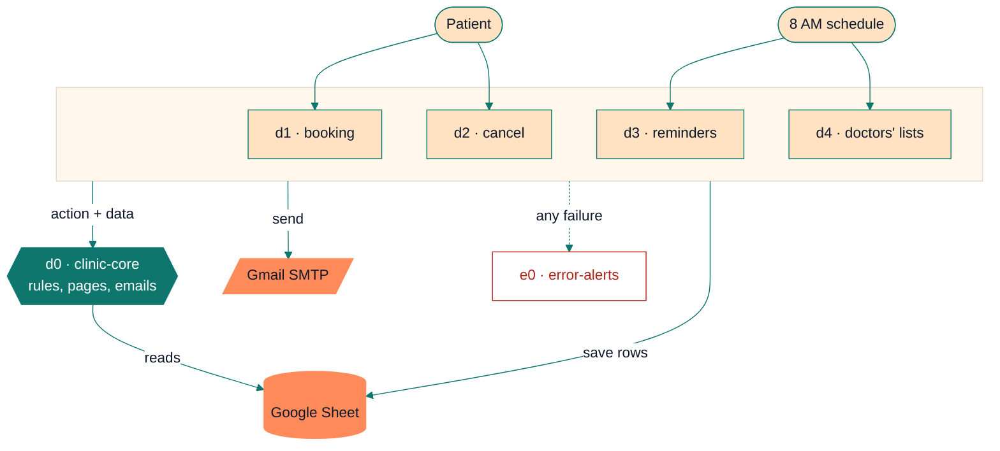

<p align="center"></p>

<p align="center">
  
  
  
  
  
</p>

# Demo Family Clinic: appointment booking in n8n

A complete booking system for a small two-doctor clinic, built from six n8n workflows and one Google Sheet. Patients book and cancel online, get a confirmation and a reminder by email, and each doctor gets their day's list every morning. The clinic and everyone in it are fictional.

**Contents:** [What it does](#what-it-does) · [What it replaces](#what-it-replaces) · [How it works](#how-it-works) · [What it handles](#what-it-handles) · [How it was tested](#how-it-was-tested) · [Sample output](#sample-output) · [Setup](#setup) · [Known limitations](#known-limitations)

## What it does

| | For the patient | For the clinic |
|---|---|---|
| **Booking** | A two-page form: details and a preferred day, then only the times that are still free. | A row in **Appointments** and one in **Request Log** for every attempt, booked or not. |
| **Confirmation** | An email with the time, doctor and token, an *Add to Google Calendar* button and a cancel link. | Nothing to do. |
| **Cancelling** | One click from the email, with a confirm step. Open until 2 hours before. | The time frees itself; the row turns grey with a timestamp. |
| **Reminders** | One email at 8 AM the day before (or on the morning of the visit, if they booked after that day's run). | The reminder column says *Sent* or *Failed* with the reason. Failed ones retry next morning. |
| **Doctors' lists** | — | Monday to Saturday at 8 AM, each doctor gets today's appointments sorted by time. |
| **Problems** | — | One *Needs attention* email naming the exact row: unreadable dates, unknown doctors, duplicate IDs, and any booking that falls on a day its doctor is away. |

Staff work in the sheet: an **Upcoming** board, the **Appointments** list, **Closures** (days off, with a date picker) and the **Request Log**.

## What it replaces

- **Phone-only booking and a paper register.** Patients pick from times that are actually free, at any hour, and the register fills itself.
- **The evening reminder calls** reception makes to tomorrow's patients.
- **Writing out each doctor's list** for the day.
- **Patients arriving on a day the doctor is away.** Closed days are never offered, and a booking that clashes with a newly added closure is flagged to reception every morning until someone deals with it.

## How it works



**d0 · clinic-core** is the only place the clinic's rules and look live. The other workflows call it with an *action* (`slots`, `check`, `booking`, `reminders`, `schedule`) and get back a decision with its page or email already built. Hours, slot length, days off, doctors, booking window and notice times are one `CLINIC` block at the top of its Rules node. d0 only reads the sheet; the callers do the writing.

| Workflow | Trigger | Stages |
|---|---|---|
| **d1 · clinic-booking** | Form at `/form/clinic-booking` | **1. Find times:** d0 checks the name, Pakistani mobile, email and date, and lists the doctor's free times. A closed, full or past day gets the next day that has times, with the reason. **2. Pick and check:** the patient picks a time (the page waits 30 minutes). d0 checks again, because someone may have taken it meanwhile. **3. Save and confirm:** the row is saved (append-or-update on `booking_id`, so a retry never duplicates it), then the confirmation email goes out. **4. Finish:** the result page, and one Request Log row whatever happened. |
| **d2 · clinic-cancel** | Link in confirmation and reminder emails | d0 looks the booking up by ID and secret token. A wrong token shows nothing about the booking. On *Yes, cancel it*, d0 is asked again (the page may have sat open, or another tab cancelled it first), then the row is marked Cancelled and the cancellation email is sent. |
| **d3 · clinic-reminders** | Every day, 8 AM | Sends reminders for tomorrow, plus today's that were booked after yesterday's run. Stamps each row Sent or Failed. One *Needs attention* email lists every row that can't be reminded and every upcoming booking on a closed day. |
| **d4 · clinic-doctor-list** | Monday to Saturday, 8 AM | Each doctor's list for today. d0 also checks the whole sheet and reports anything it can't read. |
| **e0 · error-alerts** | Any failed production run | Emails the workflow, the failed node, the error and a *Check first* hint. Shared with my Amazon Toolkit project, so it also knows those workflows. |

Node-by-node notes for each workflow are in [`workflows/README.md`](workflows/README.md). The JavaScript inside every Code node is in [`code/`](code/) as plain files, so it can be read without opening n8n.

## What it handles

**Booking**
- Two people choosing the same time: the second gets *That time was just taken* and a link back with their details filled in.
- A time that became too close (under 60 minutes away) or a closure added while the patient was choosing.
- Dates in the past, Sundays, days a doctor is away, fully booked days, more than 30 days ahead: each gets its own message and, where possible, the next day that has times.
- Phone numbers typed as `0300 1234567`, `+92 300 1234567` or `0092-300-1234567`; names typed in capitals or lower case.
- The patient declining every time, or leaving the page: nothing is booked, and it's logged as *Declined* or *Abandoned*.
- The confirmation email failing: the booking stands, the page says the email didn't send, and the failure is logged.

**Cancelling**
- Wrong, cut-off or guessed links, already cancelled, too late (under 2 hours), already passed.
- Two tabs confirming the same cancellation: one cancellation, one email.

**Mornings**
- Reminders are sent once. A failed one is retried the next morning; a sent one never repeats.
- A row that can't be reminded (no time, unknown doctor, bad email, missing or duplicate ID) is named in the attention email, never skipped silently.
- A booking on a day its doctor is away gets no reminder ("See you tomorrow" would be false) and stays on reception's list every morning until it's moved or cancelled. Patients are never emailed about it automatically, so a typo in Closures can't mislead them.
- If any email fails, the run still finishes for everyone else, then stops with the names so e0 sends an alert.

**Everywhere**
- Everything a patient types is escaped before it goes into a page or email. Sheet writes use RAW mode, so a name starting with `=` stays text and can't become a formula.
- Dates and times typed by hand in the sheet are accepted as `2026-10-20`, `10/20/2026`, `17:20`, `5:20 PM` or Sheets' own date numbers.
- All times are Pakistan time and stored with ` PKT`.

## How it was tested

**Automated** (`npm test`, about 3 seconds). The Code nodes run unchanged in a small harness that fakes n8n's `$()`, `$input` and `$now`. Node-only globals such as `URLSearchParams` are hidden, because n8n's sandbox doesn't have them. The tests run against the code pulled out of the workflow JSON, and `validate.js` also fails if a file in `code/` differs from the code in its workflow.

| Suite | Checks | What it covers |
|---|---:|---|
| `d0-rules.test.js` | 125 | Every action's decisions: free times, closures, notice and booking windows, reminder timing, clashes, the sheet health check, cancel lookups |
| `d0-templates.test.js` | 52 | Every page and email: wording, escaping, calendar links, form blocks surviving n8n's HTML sanitiser |
| `flows.test.js` | 41 | Whole workflows step by step against an in-memory sheet and mail server: races, retries, failed emails, two-tab cancels |
| `e0.test.js` | 10 | Alert labels and the *Check first* hints |
| `stress.test.js` | 24,809 | 4,000 hostile form submissions, 1,500 garbage sheets, date edge cases (New Year, leap day, exact cut-offs), and a seeded 60-day simulation with 263 bookings, checking that no time is ever double-booked, nobody gets two reminders, and every booked page's reminder promise is kept |

**Live**, on self-hosted n8n 2.43.7 in October 2026:

- [x] Full booking: form → free times → booked page → confirmation email → Appointments and Request Log rows
- [x] Invalid details (bad phone number): *Check your details* page, logged
- [x] Two tabs choosing the same time: the second gets *That time was just taken*
- [x] Declining every time, and leaving the time page until it expires: logged as *Declined* and *Abandoned*
- [x] Cancelling from the email link, and two tabs cancelling the same booking: one cancellation, one email
- [x] A doctor's day off in Closures: that day skipped, the next free day offered
- [x] Morning reminders sent and stamped; a broken row and a closure clash reported in one attention email
- [x] Pages at phone width

## Sample output

> Screenshots use the fictional sample data below. Emails are shown in Gmail.

| Booking form | Choosing a time |
|---|---|
|  |  |
| **Booked** | **Confirmation email** |
|  |  |
| **Doctor's morning list** | **Needs attention** |
|  |  |
| **Cancelled** | **The sheet: Upcoming** |
|  |  |

Dr. Ayesha Khan's list for Monday 26 October (plain-text part of the email):

```text
Good morning, Dr. Ayesha Khan

You have 4 appointments today, Monday 26 Oct.

10:00 AM  Sara Ahmed  Follow-up  0300-1234567
10:40 AM  Omar Farooq  Check-up  0321-5550142
11:20 AM  Hina Shah  Consultation  0333-4567890
5:20 PM  Zainab Malik  Check-up  0345-2223344

Prepared at 8:00 AM.
```

The same morning, reception's *Needs attention* email, after Dr. Usman Ali's conference day was added to Closures:

```text
Found by Morning reminders at 2026-10-26 08:00 PKT.

1. Row 10 (BK-K7VR5S), Fatima Noor: booked with Dr. Usman Ali for Tuesday 27 Oct, 5:40 PM,
   but Dr. Usman Ali is not available on Tuesday 27 Oct. No reminder goes out while this stands.
   Please contact the patient on 03224448899 to move or cancel it.
```

## Setup

**You need:** n8n (self-hosted; built and tested on 2.43.7), a Google account, a Gmail app password, and Node.js 18+ only if you want to run the tests.

1. **n8n setting.** Start n8n with `N8N_CONCURRENCY_PRODUCTION_LIMIT=1`. Bookings are then handled one at a time, which is what stops two people getting the same slot (see [limitations](#known-limitations)).
2. **The sheet.** Create a Google Sheet → **Extensions → Apps Script** → paste [`sheet/clinic-sheet-setup.gs`](sheet/clinic-sheet-setup.gs) → run `setupClinicSheet` → allow access. It builds the four tabs, colours, dropdowns and the date picker. The sheet ID is the long part of its URL between `/d/` and `/edit`.
3. **Google service account** (no weekly re-login). Google Cloud Console → new project → enable **Google Sheets API** → **IAM & Admin → Service Accounts** → create one → **Keys → Add key → JSON**. Share the sheet with the service account's email as **Editor**.
4. **n8n credentials.**
   - **Google Service Account API:** the service account email and the private key from the JSON file.
   - **SMTP:** host `smtp.gmail.com`, port `465`, SSL on, your Gmail address, and an [app password](https://myaccount.google.com/apppasswords) (needs 2-Step Verification).
5. **Import** the six files in [`workflows/`](workflows/), **e0 and d0 first**.
6. **Fill in the placeholders:**
   - `YOUR_SHEET_ID` in every Google Sheets node: d0 *Read Appointments* and *Read Closures*, d1 *Save Appointment* and *Log Request*, d2 *Mark Cancelled*, d3 *Save Stamp*. Pick the service-account credential in each.
   - Pick the SMTP credential in every Send Email node, and set e0's from/to address.
   - In d0 → **Clinic Rules**, the `CLINIC` block: `fromEmail`, `adminEmail`, each doctor's email, and `bookingFormUrl` / `cancelFormUrl` (your n8n address).
7. **Publish d0.** A sub-workflow has to be published before the workflows that call it.
8. **Link d0** in the six *Execute Workflow* nodes. Choosing the workflow clears the inputs below it, so re-enter them:

   | Workflow › node | action | data |
   |---|---|---|
   | d1 › Find Times | `slots` | `{{ $json }}` |
   | d1 › Final Check | `check` | `{{ { request: $('Find Times').first().json, chosen: $('Choose Time').first().json.Time ?? '', cancel_token: $json.cancel_token } }}` |
   | d2 › Find Booking | `booking` | `{{ { id: $json.id, token: $json.t } }}` |
   | d2 › Check Again | `booking` | `{{ { id: $('Find Booking').first().json.booking_id, token: $('Cancel Form').first().json.t } }}` |
   | d3 › Due Reminders | `reminders` | `{{ {} }}` |
   | d4 › Doctor Lists | `schedule` | `{{ {} }}` |

9. **Error alerts.** In d0–d4: **⋯ → Settings → Error Workflow → e0 · error-alerts**.
10. **Publish d1–d4**, then open `/form/clinic-booking` on your n8n address.

**Testing a morning run without waiting for 8 AM:** in d3 *Due Reminders* or d4 *Doctor Lists*, set data to `{{ { test_now: '2026-10-26 08:00' } }}`, run it, then set it back to `{{ {} }}`.

**Running the tests:**

```bash
npm install
npm test
```

**Changing the clinic:** hours, slot length, days off, notice times, doctors and visit types are all in the `CLINIC` block. Doctor and visit-type names must match the dropdowns on the d1 form and the lists at the top of the sheet script. A mismatch stops with a clear error, and e0 emails you.

## Known limitations

- **Links point to `localhost:5678`** until `bookingFormUrl` and `cancelFormUrl` are set to an n8n address patients can reach.
- **No double booking only while `N8N_CONCURRENCY_PRODUCTION_LIMIT=1`.** Bookings are checked and saved one at a time. With parallel runs, two people could pass the final check for the same slot at the same moment.
- **Staff edit the sheet directly** for closures, phone bookings and changes. Hand edits don't email the patient, and clashes are reported to reception rather than sent to patients.
- **Fixed to one clinic's shape:** Pakistani mobile numbers, Pakistan time, the same hours for every doctor, one slot length.
- **Mornings depend on n8n being up at 8 AM.** A missed run isn't replayed. A reminder that was due still goes out the next morning if the visit hasn't happened yet; that day's doctors' lists don't.
- **Anyone with a cancel link can cancel that booking**, as with most booking emails. The token is a random UUID, and online cancelling closes 2 hours before the appointment.
- **The time-picking page waits 30 minutes**; after that nothing is booked and the attempt is logged as *Abandoned*.
- **Gmail SMTP** allows roughly 500 emails a day on a personal account.
- **Form styling** targets n8n 2.x's form pages; other versions may render them differently.
